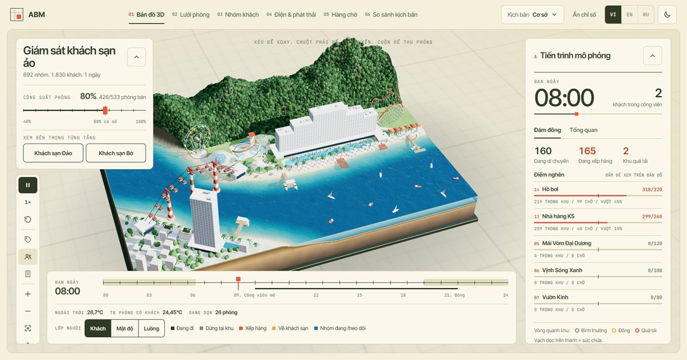

# Virtual Hotel Monitoring

[](https://github.com/khoisday/abm/actions/workflows/tests.yml)

**Live demo:** https://abm.icclab.site (mirror: https://virtual-hotel-monitoring.vercel.app)



Agent-based simulation of guest behaviour across an integrated **533-room hotel and amusement park** on a tropical
island resort, with a second **208-room hotel on the mainland**, a **cable car** and **speedboats** across the strait
and day visitors from the city. It links guest choices to hotel and park operations, then to electricity,
electricity-related emissions, queues and service outcomes. Three views replay the simulation:
- a Streamlit dashboard;
- a static web dashboard (`/dashboard` on the site);
- a 3D diorama map, the site's home page. Clicking either hotel opens a panel with a floor cross-section, the
  room grid of each floor and each room's day from the ABM run; the tower is cut open at that floor. The occupancy
  slider switches between real runs at 40–100% occupancy.

> **Synthetic research prototype.** It is not a validated operational replica and not a live digital twin. All
> behaviour, capacities, travel times, weather and equipment parameters are synthetic assumptions.

## Install and launch (Windows, Python 3.12 tested)

```powershell
pip install -r requirements.txt

# 1) Interactive dashboard (http://localhost:8501)
streamlit run app.py

# 2) Command line: 533-room baseline, seed 42, 1 day -> outputs/baseline_seed42/
python run_simulation.py
python run_simulation.py --scenario combined --seed 7 --days 3 --occupancy 0.53

# 3) Paired comparison: 6 scenarios x 10 seeds -> outputs/scenario_summary.csv, outputs/per_seed_comparison.csv
python run_simulation.py --compare --seeds 10

# 4) Verification (diagnostic / full / 100% stress / 0% boundary / zero factor / reproducibility) and tests
python run_simulation.py --verify-suite
python -m pytest -q

# 5) Static website -> site/ (3D map home page + dashboard + precomputed JSON/CSV, ~3 min)
python build_site.py
```

Each CLI run also writes a standalone 3D view, `outputs/<run>/<run>_resort3d.html`. It loads three.js, GSAP and
Google Fonts from CDNs, so it needs internet access.

### Hosting the static site
The site has no backend, so any static host works:
- **Vercel**: `cd site; vercel deploy --prod`.
- **Cloudflare Pages**: `npx wrangler pages deploy site`, or connect the repository.
- **GitHub Pages**: `python publish_pages.py` pushes `site/` to a `gh-pages` branch.

The Streamlit dashboard needs a long-running Python server, for example Streamlit Community Cloud or a VPS.

## Source data (local only)
The source files are not committed:
- the green-tourism assessment workbook `assessment_answers_categorized.xlsx`;
- the reference load profile `*_15min_NREL.csv`;
- two illustrated maps.

Simulation, tests and site build all run without them. When they are absent, the self-reported grid reference
and the load-shape comparison are skipped. To rebuild `rule_registry.csv` (`python -m simulation.inputs`), add
the workbook and put the assessed property's name in `config/source_data.json` as `{"facility": "..."}`.

## What is modelled

- **Rooms.** 533, a fixed inventory. At 80% occupancy, 426 rooms are sold and get one guest group each; that is
  1,135 guests with seed 42. The 107 unsold rooms stay in the electricity accounting.
- **Guest-group agents.** A group keeps its identity across room → breakfast → walk along the promenade → park →
  meals/rest → walk back → dinner → room. Preferences vary within solo/couple/family/friends groups. Each group also has:
  - a budget and a queue tolerance;
  - a conservation preference and a probability of accepting recommendations;
  - bounded 0–100 indices for hunger, fatigue and heat discomfort.
- **Decisions.** Infeasible options are filtered out. The remaining options are scored by utility (preference,
  interest, hunger/fatigue/heat relief, travel, expected wait, price, repeat visits, schedule conflict) and one is
  chosen with a numerically stable softmax. Groups see posted waits with noise, not future queues. The components
  of every decision are logged.
- **Second hotel and day visitors.** The mainland hotel has 208 rooms (72% sold, one group per room) with a café,
  spa and gym; 60% of its groups go to the park. 300 day visitors a day come from the city. Both kinds of guest use
  the same decision model in the park and keep their identity across the whole trip.
- **Environment and transport.** A schematic walking graph in three zones (island hotel, park, mainland) with
  cached shortest paths. Island guests walk between the hotel and the park gate along the promenade (14 min);
  there is no shuttle on the island. Three finite-capacity lines carry everyone else:
  - cable car, mainland ↔ park (2 cabins × 8 persons every minute, 09:00–22:00);
  - speedboats, mainland pier ↔ island pier (20 persons, every 20 min when someone waits); island guests use them
    for evening city outings, and everyone uses them after the cable car closes;
  - the mainland hotel's shuttle, its car park ↔ the cable-car station (minibus, 25 persons every 10 min,
    08:00–22:30), used by mainland-hotel guests on their way to and from the cable car.
  Groups never split when boarding, and nobody is left at a stop at the end of the day.
- **Facilities.** FIFO queues with fill-in and anti-starvation rules. Types:
  - park: batch rides, a continuous indoor attraction, scheduled shows, a restaurant, rest areas;
  - island hotel: restaurant, pool, spa, gym, kids club, **lobby bar and sky bar**;
  - mainland hotel: café, spa, gym; plus a city outing outside the energy boundary.
- **Queue rules.** Opening hours, a closing grace period, balking, abandonment and rejection.
- **Room thermal model.** Vectorized and first-order, on a 1-minute step. It includes a deadband thermostat and
  keycard / bypass / setback / pre-cooling logic. Pre-cooling uses predicted return times with error, never the
  actual future return.
- **Housekeeping.** 26 attendants with shifts. Privacy rules: rooms are cleaned only while guests are away, and
  DND is respected. The model also covers interruptions when guests return, towel and linen requests, and the
  laundry demand they create.
- **Laundry.** A finite number of machines running batches. The kilograms left over and the energy needed to
  finish them are reported.
- **Electricity.** 16 end uses in four boundaries (island hotel, park, mainland hotel, transport), aggregated into
  15-minute intervals. Emissions = kWh × factor (illustrative 0.60 kg CO2e/kWh, or a time-varying CSV). Cable-car
  electricity is included; shuttle electricity is excluded by default, and that boundary is shown. Speedboat fuel is
  estimated separately (litres and kg CO2e) and is not added to electricity emissions.
- **Scenarios.**
  1. Baseline.
  2. Occupancy-based room HVAC.
  3. Housekeeping and towel-reuse coordination.
  4. Park recommendations.
  5. Ride-dispatch coordination.
  6. All of the above combined.

## Repository layout

```
app.py                      Streamlit dashboard (Vietnamese UI)
run_simulation.py           CLI entry point
build_site.py               static site build (dashboard + 3D maps + data)
publish_pages.py            publish site/ to a gh-pages branch
simulation/                 config, rng streams, environment, agents, decisions, energy, engine, scenarios,
                            metrics, layout (room floor plan), inputs (source-file inspection), viewer (3D payload)
web/dashboard.html          static dashboard: rooms, groups, energy, queues, compare, data (plain JS + SVG)
web/resort3d_template.html  3D map with the hotel floor/room panel (three.js r147 + GSAP 3.12.5)
web/i18n.js  i18n_dict.json  VI / EN / RU switch for both pages; table keyed by the Vietnamese text, inlined at build
config/defaults.json        all synthetic parameters
tests/                      pytest verification tests
assumptions.csv  verified_facts.csv  data_provenance.md  rule_registry.csv
docs/                       data plan for calibration / digital-twin work (.md, .docx)
```

## Verification (measured 2026-10-22)

- `pytest`: **24 passed**.
- `--verify-suite`: 19/19 model checks pass in every run.

  | Run | Runtime |
  |---|---|
  | Diagnostic, 60 rooms | 1.5 s |
  | 533 rooms at 80% (+ mainland hotel and day visitors) | 5.9 s |
  | 533 rooms at 100% (1,433 island guests) | 7.2 s |
  | 533 rooms at 0% (island base loads; mainland and day visitors still run) | 2.8 s |

- A zero emission factor gives 0 kg. The same seed and policy give identical results.
- What the checks cover:
  - inventory: 533 unique island rooms, occupancy, one valid room per group in each hotel (day visitors have
    none), the mainland hotel's room count and occupancy, group composition;
  - flows: visitor conservation in every 5-minute snapshot, travel takes time, facility, shuttle, cable-cabin and
    boat capacities hold, no line leaves before its first departure, no admissions after closing, no stranded
    groups, no worker doing two tasks at once;
  - energy accounting: vacant-room standby, end uses sum to the total, energy equals integrated power, 15-minute
    and 1-minute totals agree, emissions equal kWh × factor;
  - outstanding work is reported.
- The 6 × 10 paired comparison (60 runs) took 375 s.

## Computed baseline (seed 42, 1 day, synthetic)

| Metric | Value |
|---|---|
| Total electricity | 22,124 kWh (island hotel 11,442, park 4,493, mainland hotel 3,599, cable car 2,590; shuttle excluded) |
| Peak 15-min power | 1,325 kW |
| Electricity-related emissions | 13,274 kg CO2e (illustrative factor) |
| Island hotel kWh per occupied room-night | 26.9 (mainland hotel 24.0) |
| Park entries | 543 groups (island, mainland and day visitors) |
| Cable car / speedboat / mainland shuttle passengers | 1,114 / 226 / 514; boat fuel 198 L (≈ 455 kg CO2e, reported separately) |
| Mean attraction wait | 6.4 min; 160 abandoned queue joins |
| Hot occupied room-hours (> 27 °C, island) | 132 |

**Nothing has been calibrated.** The self-reported grid electricity in the assessment workbook is much higher.
Several loads are not modelled (central chiller plant, conference, staff areas…), and the boundary of the
self-reported figure is unknown.

## Paired comparison (10 seeds, mean paired difference vs baseline ± SD)

Source: `outputs/scenario_summary.csv`. Baseline mean over the 10 seeds: 22,256 kWh.

- **Occupancy HVAC**: +337 ± 19 kWh (+1.5%). A 28 °C setback replaces the keycard shut-off in both hotels. In
  return, hot occupied room-hours on the island fall from 126 to 1.0.
- **Housekeeping coordination**: −108 ± 11 kWh (−0.5%), but with two costs:
  - hot room-hours rise by 76, because HVAC stays off during cleaning;
  - about 23 more rooms are left uncleaned.
- **Recommendations**: −10 ± 24 kWh. Mean wait −0.00 ± 0.17 min and 5 ± 13 fewer abandoned queue joins, all
  within seed noise.
- **Ride dispatch**: −85 ± 21 kWh (−0.4%). Mean wait +0.13 ± 0.29 min.
- **Combined**: +196 ± 41 kWh (+0.9%). Overheating drops to near zero, but about 23 more rooms are left
  uncleaned.

These are synthetic tradeoffs that illustrate the mechanism. The ranges show seed-to-seed variability; they are
not confidence intervals and not validation.

## Limitations

- Not modelled within the horizon: check-in/check-out, on-site PV and water use. Boat fuel is a rough estimate.
- The mainland hotel has rooms, guests and energy but no housekeeping or laundry model.
- Guests are modelled at group level: members of a group never split up.
- Attraction names, capacities, hours, staffing and geometry are generic. The map is schematic and not to scale.
- There is no calibration or external validation yet. `docs/ke_hoach_du_lieu_digital_twin.md` lists the data
  this would need.
